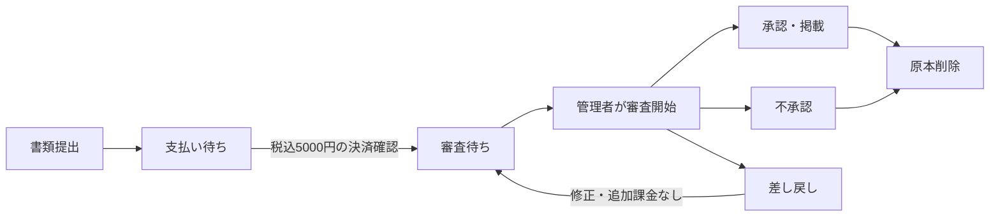

# 構成と運用

## 最小構成

- Next.js 16 / React 19 / TypeScript。六つの画面とAPIを一つのNode.jsプロセスで実行。
- Node.js内蔵SQLiteを使い、`DATA_DIR/site.sqlite` と非公開の `DATA_DIR/uploads` に保存。外部DBやメール配信契約は不要。
- チャットは5秒間隔の取得。約300人の想定でWebSocket専用サーバーを追加しない。
- 全データはサーバーに保存。ブラウザーのlocalStorageを認証/権限の根拠にしない。

## アクセスと情報

| 情報 | 閲覧可能者 |
|---|---|
| 公開プロフィール、単一のIQ参考値、検査値・検査日・生活習慣 | 誰でも |
| 生年月日・メール | 本人、審査時の管理者 |
| 学校・学部・学科、任意の顔写真 | 本人・管理者、提供者が許可した承認済みの会話相手 |
| 本人確認・各証明書の原本 | 本人・管理者。承認/不承認後に削除 |
| 会話・添付画像 | 当事者・管理者。管理者はメッセージを送れない |

認証はメール/パスワード、scryptによるハッシュ、ランダムなセッションとHttpOnly Cookieを使用します。HTTPS設定ではSecure Cookie、SameSite=Lax、更新APIでOriginを照合します。管理者を一般の登録APIから作成できません。ログイン等の回数制限も設けています。希望者は申告生年月日による成人確認です。メール確認・パスワード再発行・二要素認証は初期版に含めていません。

画像はJPEG/PNG/WebPを実際にデコードし、メタデータを除いてWebPへ変換します。画像5MB、証明書8MBまで。証明書PDFは非公開の認証付きダウンロードです。`public` フォルダーに個人ファイルを置きません。原本のOCR・自動本人確認は行わず、管理者が確認します。

## 申請と料金

初回と証明書更新は同じ流れです。同時更新は申請単位で5,000円。支払い完了を確認する前に管理者が審査を開始できません。提供曜日・地域等の証明不要の提供条件だけなら無料で更新できます。既存の審査済み値は、新しい更新審査を承認するまで維持します。決済手続き開始前の未払い申請は取り消せます。決済注文を作成した後の取り消しは誤課金を避けるため制限しています。

PayPalはサーバーから注文を作成・売上確定し、通貨JPY・金額5,000・申請ID・完了状態を照合します。注文と売上確定に申請単位の冪等キーを使います。ブラウザーが返す「支払い済み」という値は信用しません。Webhookによる自動回収は初期版に含めず、戻り画面と「支払い完了を再確認」でサーバーが照合します。戻り前に画面を閉じた場合も、登録画面から再確認してください。返金APIは初期版に含めません。

## 会話と記録

希望者が申請し、提供者が承認してからテキスト・画像を送信できます。顔写真と学歴の許可は会話単位で取り消せます。許可取消後はAPI/ファイル取得を即時に拒否します。相手がすでに見た情報や端末へ保存した画像の回収はできません。画面は定期取得で状態を反映します。

提供・妊娠・出生の記録は提供者が登録し、希望者が確認します。公開件数には確認済みの提供・出生のみ反映します。運営が実際の提供・妊娠・出生を医学的に認定するものではありません。謝礼の合意・送金はサイト内の機能に含めません。

## 削除と休止

承認/不承認後、提出原本のDB行とファイルを削除します。差し戻し中は再照合のため保持します。審査済みの入力値・申請状態・本人確認済みの印は退会まで保持します。提出前の添付ファイルは本人が取り消せます。

退会は本人の確認操作を伴い、プロフィール・申請・セッション・会話・実績を削除します。関連する会話の相手側添付画像も削除します。相手には本人を識別できない「会話先が退会したため閲覧できません」という状態だけを残します。SQLiteのsecure_delete、WALチェックポイント、VACUUMを使います。削除に失敗したファイルはランダムな保存キーだけを再処理キューに残して次回起動時に削除します。削除済みDB行に対応するファイルはAPIから取得できません。

本人の募集休止と管理者の掲載停止を区別し、管理者停止を本人が解除できないようにしています。検査結果の2年経過は表示しますが、自動停止や再検査の強制は行いません。

## 再起動・保存

DBとアップロード先は同じ永続ディスクに置きます。複数サーバーでローカルSQLiteを共有する構成には対応していません。プロセス再起動時はデータを維持します。初回起動用管理者のパスワードを変更するには、既存管理者を安全な運用手順で更新する必要があります。環境変数を変更するだけでは既存パスワードは変更しません。

このアプリは自動バックアップやアクセスログへの個人情報出力を設けていません。ホストのアクセスログ・バックアップ・ディスク暗号化と、運営者の端末にダウンロードした原本の削除は別途管理してください。実際の利用者を入れる前に、運営者情報・返金方針・決済利用可否・保存期間を確定する必要があります。
